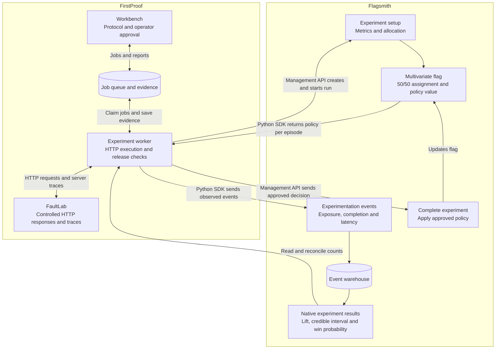

# FirstProof

FirstProof is a release verification workbench for Flagsmith. Flagsmith assigns each test episode to a policy, measures the outcomes, and applies the approved rollout. FirstProof runs the HTTP workload and checks whether the change meets the release criteria.

The included experiment looks at a problem that can affect integrations serving multiple customers. When one workspace hits an API rate limit, a shared client queue can hold up requests from another workspace. FirstProof compares that shared cooldown with a cooldown scoped to the affected workspace and API method.

The project was built for Track 01 of the Toggle Wars Flagsmith hackathon.

## Contents

- [The experiment](#the-experiment)
- [Architecture](#architecture)
- [Requirements](#requirements)
- [Run a local replay](#run-a-local-replay)
- [Run with Docker Compose](#run-with-docker-compose)
- [Run a Flagsmith experiment](#run-a-flagsmith-experiment)
- [Configuration](#configuration)
- [Tests](#tests)
- [Project structure](#project-structure)
- [Limitations](#limitations)
- [Documentation](#documentation)

## The experiment

Each experiment episode contains two workspaces making the same read request. Workspace A may receive a `429` response with a `Retry-After` header. Workspace B is healthy. The two policies differ in how they handle the wait:

| Policy | Behavior |
| --- | --- |
| Shared cooldown (control) | A rate limit pauses requests from both workspaces. |
| Workspace-scoped cooldown (candidate) | The cooldown applies to the affected workspace and method. |

The primary metric is the proportion of episodes in which B returns the expected response within 500 ms of enqueueing the request. FirstProof also records B's response time, A's recovery, retry timing, response validity, and the total number of upstream attempts.

FaultLab, the included upstream service, returns controlled HTTP responses and keeps a separate trace of received requests. The runner uses a fixed seed to generate healthy, overlapping, boundary, and non-overlapping episodes. Their weights are part of the experiment protocol and are benchmark assumptions.

The shared-queue scenario is based on [Slack's rate-limit documentation](https://docs.slack.dev/apis/web-api/rate-limits/) and the queue handling in [version 7.16.0 of its Node SDK](https://github.com/slackapi/node-slack-sdk/blob/%40slack%2Fweb-api%407.16.0/packages/web-api/src/WebClient.ts#L686). FirstProof models this behavior using its own HTTP client and FaultLab.

See [the experiment protocol](docs/EXPERIMENT_PROTOCOL.md) for the workload mix, measurements, and release criteria.

## Architecture



| Live experiment stage | What Flagsmith does |
| --- | --- |
| Set up the experiment | The Management API creates the experiment and metrics, sets the allocation, and starts the run. |
| Choose the policy | The Python SDK returns the assigned variant and its remote config value for each episode. The worker uses that value to decide which cooldown policy runs. |
| Collect and analyze results | Experimentation records exposures, verified completion events, and latency in the connected warehouse. Flagsmith computes lift, credible intervals, and win probability. FirstProof compares aggregate counts with the HTTP evidence and checks the guardrails. |
| Apply the decision | After operator approval, the Management API completes the experiment and applies the selected policy in the sandbox. FirstProof reads the resulting flag through the SDK and runs a fresh overlapping episode. |

The workbench shows the local evidence behind each result, including the breakdown by scenario, request traces, and release checks. Operators can export the observations as JSON or publish a read-only report. Live runs require Flagsmith for assignment, experiment results, and completion. The local replay has its own assignment path so it can run without credentials.

FirstProof also includes the original search-client retry experiment and an optional research workflow using SerpAPI and OpenRouter. Those services are not required for the workspace cooldown study.

## Requirements

- Python 3.12 through 3.14.
- Docker and Docker Compose for the PostgreSQL deployment.
- A Flagsmith environment with Experimentation enabled and a connected warehouse for live experiments.
- A dedicated PostgreSQL database and Flagsmith management credentials for live mode.

The local replay uses SQLite and does not require Docker, Flagsmith, or API credentials.

## Run a local replay

Clone the repository and create a virtual environment:

```bash
git clone https://github.com/Ananay28425/FirstProof.git
cd FirstProof
python -m venv .venv
```

Activate the environment:

```powershell
# Windows PowerShell
.venv\Scripts\Activate.ps1
```

```bash
# macOS or Linux
source .venv/bin/activate
```

Install the project and start the local services:

```bash
python -m pip install -e ".[dev]"
python scripts/local.py
```

Open [http://127.0.0.1:8000](http://127.0.0.1:8000) and sign in with the operator token printed in the terminal. On the experiments page:

1. Select **Workspace cooldown · pinned Slack sources**.
2. Choose the number of workloads and prepare the protocol.
3. Review the protocol and select **Approve protocol & execute**.
4. Open the results to inspect the policy comparison and episode traces.

The script starts the workbench, worker, and FaultLab on loopback ports 8000 and 8001. Press `Ctrl+C` to stop them. It stores replay data in `local-replay.db`, which persists between runs.

Local mode assigns episodes using a test double. Its report is labeled as a local replay and cannot authorize a Flagsmith rollout.

## Run with Docker Compose

Copy `.env.example` to `.env`, then set `POSTGRES_PASSWORD`, `OPERATOR_TOKEN`, and `FAULTLAB_TOKEN`. Generate a separate URL-safe value for each:

```bash
python -c "import secrets; print(secrets.token_urlsafe(32))"
```

Start the stack:

```bash
docker compose up --build
```

The workbench is available at [http://127.0.0.1:8000](http://127.0.0.1:8000). Compose starts PostgreSQL, runs the database migration, and launches the web, worker, and FaultLab services. PostgreSQL data is stored in the `pgdata` volume.

For an externally accessible deployment, configure HTTPS, `PUBLIC_ORIGIN`, and `SECURE_COOKIES`. See [the deployment guide](docs/DEPLOYMENT.md) for the remaining setup and recovery steps.

## Run a Flagsmith experiment

Follow [the integration runbook](docs/INTEGRATIONS.md) to configure a dedicated Flagsmith project, warehouse, and multivariate flag. The default flag name is `firstproof_workspace_cooldown`. Its control value is `shared_cooldown`, and the candidate value and key are `workspace_method_cooldown`.

Set `MODE=live` and the required database, Flagsmith, and operator settings in `.env`. Start the services, then:

1. Run a pilot in a dedicated Flagsmith environment and verify that exposure and outcome counts reconcile.
2. Configure a separate environment for the main study. Choose the sample size, seed, and protocol before starting it.
3. Approve the protocol in FirstProof. The worker creates the metrics and experiment, then runs the HTTP episodes.
4. Refresh and read the native results after event ingestion. Compare the results, scenario breakdown, and guardrails in the workbench.
5. Approve the appropriate completion action. FirstProof reads back the selected flag and runs a fresh episode in the experiment sandbox.

Candidate promotion requires reconciled counts, supporting native statistical results, passing safety and resource checks, and reserved validation. If a gate fails, the operator can retain the control. Approval applies to the dedicated experiment environment. The application does not automatically change a separate production environment.

The operator approves the exact protocol and reviews the decision before completing the experiment. By default, the candidate needs a positive native credible interval, at least a 95% chance to beat control, a conservative improvement lower bound of five percentage points, no observed reduction in A's recovery, and no more than a 10% increase in mean upstream attempts. Safety violations, incomplete traces, or failed reserved validation block promotion.

FirstProof checks Flagsmith's sample ratio diagnostic alongside its own exposure counts. If a Flagsmith build returns no diagnostic, FirstProof can calculate a separately labeled check using the reconciled counts and a verified 50/50 rollout. The release gate still blocks a reported mismatch or an unavailable check.

For a rough sample-size estimate, provide a baseline completion rate and expected absolute change:

```bash
python scripts/sample_size.py --baseline 0.55 --delta 0.10
```

The estimate targets a nonzero effect. The release gate's practical improvement threshold may require more observations.

## Validation results

A disposable self-hosted Flagsmith run completed 160 episodes using Python SDK 6.7.0. Workspace B met its deadline in 46 of 87 control episodes and 73 of 73 candidate episodes. Workspace A recovered in all 160. Mean upstream attempts increased 4.0% for the candidate, within the configured limit.

Flagsmith exposure and outcome counts matched FirstProof's aggregate observations. The candidate passed reserved validation, was approved in the sandbox, and completed a fresh post-rollout replay. The scenario weights and infrastructure were controlled for this run. These results describe that workload.

The validation report records the SDK and image used, browser and PostgreSQL checks, and remaining integration work. The official study has not been run. See [`docs/VALIDATION.md`](docs/VALIDATION.md).

## Configuration

All settings are listed in [`.env.example`](.env.example). The main groups are:

| Settings | Purpose |
| --- | --- |
| `MODE`, `DATABASE_URL` | Select local replay or live operation and configure the FirstProof database. |
| `OPERATOR_TOKEN`, `PUBLIC_ORIGIN`, `SECURE_COOKIES` | Configure operator access and the workbench origin. |
| `FAULTLAB_URL`, `FAULTLAB_TOKEN` | Connect the worker to the controlled upstream service. |
| `FLAGSMITH_ENVIRONMENT_KEY`, `FLAGSMITH_ADMIN_KEY` | Configure SDK evaluation and management API access. |
| `FLAGSMITH_PROJECT_ID`, `FLAGSMITH_FEATURE_ID`, `FLAGSMITH_CANDIDATE_ID`, `FLAGSMITH_FLAG` | Identify the project, flag, and candidate variant. |
| `FLAGSMITH_API_URL`, `FLAGSMITH_EVENTS_URL`, `FLAGSMITH_DASHBOARD_URL` | Configure Flagsmith endpoints. Cloud uses the default event endpoint when `FLAGSMITH_EVENTS_URL` is empty. |
| `SERPAPI_KEY`, `OPENROUTER_API_KEY`, `OPENROUTER_MODEL` | Configure the optional search and scenario-proposal workflow. |
| `MAX_JOBS`, `WORKLOAD_CONCURRENCY`, `MAX_WORKLOADS`, `SESSION_SEARCH_LIMIT` | Bound job admission, workload execution, and research requests. |

Compose also requires `POSTGRES_PASSWORD`. Keep `.env` and credentials outside version control. The optional release environment settings are described in the integration runbook.

## Tests

```bash
python -m pytest -q
```

The suite covers protocol validation, retry and cooldown behavior, provider contracts, the release gate, and local HTTP replay. To exercise the queue test against PostgreSQL, set `TEST_POSTGRES_URL` to a **disposable test database** before running the suite. The PostgreSQL fixture drops its test tables.

The optional browser smoke test requires Playwright and Chromium:

```bash
python -m pip install playwright
python -m playwright install chromium
python scripts/browser_smoke.py
```

The smoke test starts isolated local services, runs a replay through the workbench, and writes screenshots and a JSON report to `artifacts/`. See [the validation report](docs/VALIDATION.md) for results and checks that remain open.

## Project structure

```text
firstproof/
├── config.py          Settings and live-mode validation
├── contracts.py       Protocol and evidence schemas
├── cooldown.py        Two-workspace episode runner
├── db.py              Experiment records and job queue
├── faultlab.py        Controlled HTTP upstream and request traces
├── integrations.py    Flagsmith, SerpAPI, and OpenRouter adapters
├── policies.py        Search-client retry policies
├── verification.py    Outcome aggregation and release checks
├── web.py             FastAPI workbench
├── worker.py          Experiment execution and reconciliation
├── static/            Workbench CSS and JavaScript
└── templates/         Jinja templates

docs/                  Protocol, deployment, and integration guides
migrations/            Alembic migrations
scripts/               Local startup, browser smoke, and sizing helpers
tests/                 Automated tests
```

## Limitations

- The workload is controlled and synthetic. Its scenario mix does not estimate the frequency or impact of real Slack incidents.
- FaultLab models the upstream response and shared cooldown behavior. The experiment does not run Slack's SDK or send requests to Slack.
- Live reconciliation compares aggregate warehouse counts with local observations. It does not prove a per-identity warehouse match.
- The workbench supports a single operator and optional public read-only reports. It does not provide multi-tenant accounts.
- FaultLab keeps episode state in one process. A replicated deployment needs request affinity or a shared state design.
- Load capacity, public deployment, and security certification have not been established. See [the validation report](docs/VALIDATION.md) for the tested scope.

## Documentation

- [Experiment protocol](docs/EXPERIMENT_PROTOCOL.md)
- [Flagsmith and provider integration](docs/INTEGRATIONS.md)
- [Architecture](docs/ARCHITECTURE.md)
- [Deployment and recovery](docs/DEPLOYMENT.md)
- [Validation](docs/VALIDATION.md)
- [Security](docs/SECURITY.md)
- [Submission notes](docs/SUBMISSION.md)

## License

[MIT](LICENSE)
