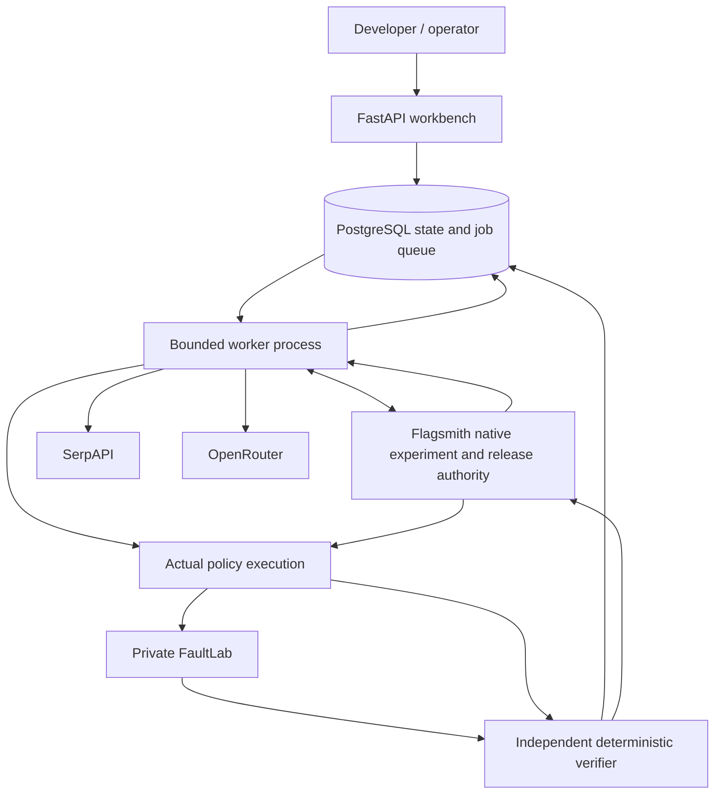

# Architecture and engineering decisions

## Responsibility and trust boundaries

Flagsmith is authoritative for feature values, assignment, exposure/conversion attribution, native statistics and sandbox completion. FirstProof owns evidence, immutable protocols, HTTP execution, independent raw verification, action authorization and local reconciliation. The model cannot call management APIs, edit evaluator code or approve its own plan. All admin IDs are server-configured. PostgreSQL is authoritative only for FirstProof state, not Flagsmith state.

## Lifecycle

`draft → queued → running → awaiting_native → analyzed → releasing → retained/promoted`. Research starts in `researching`, returns to `draft`. `replay_complete` is local-only. `interrupted` is fail-closed after a possibly ambiguous external effect. A job and the corresponding state transition are committed together. All mutation approvals bind to a protocol hash or result hash, and worker mutations require a current lease. Native operations are journaled before dispatch. No automatic retry of a partly executed experiment or a possibly successful external mutation. Interrupted runs require human review.

## Scope decisions

- A PostgreSQL-backed leased job table replaces the previously proposed Procrastinate dependency. It makes atomic state+enqueue straightforward without a second queue schema or dependency. It is intentionally a small, specialized queue, not a generic task platform. PostgreSQL row locking is used in live mode; SQLite is explicitly single-worker local only. Retry and lease behavior needs actual PostgreSQL concurrency validation.
- Jinja2 + CSS and tiny vanilla JavaScript replace HTMX/Chart.js/Tailwind for the initial build to eliminate CDN/build dependencies; server-rendered pages show actual results with native HTML meters and tables. Later enhancement does not change architecture.
- One protected operator and opt-in public read-only reports, rather than claimed multi-tenant SaaS. No registration or tenant isolation is implemented. A multi-user deployment needs a proper identity provider, workspace-scoped authorization, and per-tenant quotas before launch.
- OpenRouter is the sole implemented model provider; provider-neutral proposal function can be adapted to NIM/Groq later. No automatic provider failover is claimed.
- No Redis, Kafka, Kubernetes, local GPU, agent shell or arbitrary test code. Separate processes share one codebase. FaultLab maintains per-workload time state in one bounded process. To scale it horizontally, use consistent routing or a dedicated worker-local FaultLab with per-run affinity.

## Experimental limits

The controlled benchmark performs actual HTTP requests with independently seeded, time-based fault profiles. Two policies share the same deadline, attempts, retryable status set, jitter foundation, Retry-After compliance and response contract. The candidate caps jitter by remaining budget while preserving a server's required delay. Neither knows the workload family. The external report justifies test inclusion, not prevalence. The verifier compares expected fixture content and client/server traces. Neither policy's response is fabricated. Clock overshoot tolerance of 10ms is explicitly separate from the exact primary deadline. The reserved paired check is limited and not hidden from the developer. The result is a conditional benchmark, not evidence of behavior under thousands of real customers.

## Reliability and scaling

API routes are synchronous DB work in FastAPI's thread pool; expensive work lives outside the web process. Workers are bounded by job admission, connection pools and per-run concurrency. PostgreSQL `FOR UPDATE SKIP LOCKED` handles claiming. Worker lease heartbeats, fence checks and explicit interruption preserve auditability rather than pretending exactly-once external execution. Durable outbox state distinguishes pending, submitted to SDK, aggregate-reconciled. No automatic conversion resend after ambiguous external effects. As traffic grows, introduce real per-tenant quotas, edge rate limits, DB connection pooler, additional read-only caches and provider quota-aware scheduling. Capacity is unmeasured; do not advertise it as proven.
